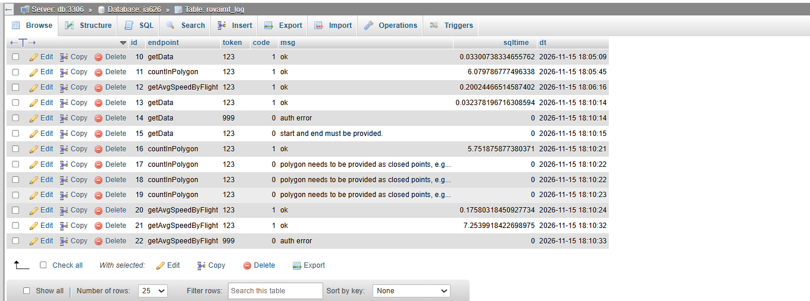

# ADS-B API

A Flask API for the ADS-B flight data in the MySQL table `class_datapoints`.

- `main.py`: the API
- `test-client.py`: test client that calls every endpoint

Every request needs `key=123`. Keys are checked in the `rovaimt_auth` table, and every request is logged in the `rovaimt_log` table.

Base URL: `http://127.0.0.1:5000`

## Endpoints

| Endpoint | Parameters | Notes |
|---|---|---|
| `/getData` | `key`, `start`, `end` | Data points from start to end. Start and end required. Max 500 results. |
| `/countInPolygon` | `key`, `polygon` | Number of data points inside the polygon. Points are `x y` separated by commas; the last point must equal the first. |
| `/getAvgSpeedByFlight` | `key`, `start` (optional), `end` (optional) | Average speed (`gs`) per flight. Max 500 results. |

## JSON schema

### Keys in every response

| Key | Type | Meaning |
|---|---|---|
| `code` | integer | 1 = successful, 0 = request failed |
| `msg` | string | `ok`, or why the request failed |
| `req` | string | which endpoint was requested |
| `sqltime` | number | seconds the SQL query took (0 if no query ran) |

### getData

```json
{
    "req": "getData",
    "sqltime": 0.0323,
    "code": 1,
    "msg": "ok",
    "results": [
        {
            "dpid": 1,
            "date_time": "2022-11-23 05:28:10",
            "hex": "4077d4",
            "flight_num": "VIR10H",
            "squawk": 1573,
            "lat": 41.208801,
            "lon": -73.198364,
            "fid": 1,
            "gs": 470.8,
            "alt_gps": 22700,
            "alt_baro": 22625,
            "cat": "A5",
            "track": 53.2,
            "nav_heading": 61.9
        }
    ],
    "num_results": 1
}
```

| Key | Type |
|---|---|
| `results` | list of data points |
| `results[].dpid`, `fid`, `squawk`, `alt_gps`, `alt_baro` | integer |
| `results[].date_time` | string, `YYYY-MM-DD HH:MM:SS` |
| `results[].hex`, `flight_num`, `cat` | string |
| `results[].lat`, `lon`, `gs`, `track`, `nav_heading` | number (or null) |
| `num_results` | integer |

### countInPolygon

```json
{
    "req": "countInPolygon",
    "sqltime": 5.75,
    "code": 1,
    "msg": "ok",
    "polygon": "Polygon((-74.0 42.0,-75.0 39.0,-74.0 41.0,-74.0 42.0))",
    "count": 9368
}
```

| Key | Type |
|---|---|
| `polygon` | string, the polygon that was searched |
| `count` | integer, number of data points inside it |

### getAvgSpeedByFlight

```json
{
    "req": "getAvgSpeedByFlight",
    "sqltime": 0.1758,
    "code": 1,
    "msg": "ok",
    "results": [
        {
            "flight_num": "AAL146",
            "avg_speed": 431.5
        }
    ],
    "num_results": 56
}
```

| Key | Type |
|---|---|
| `results` | list of flights |
| `results[].flight_num` | string |
| `results[].avg_speed` | number (or null) |
| `num_results` | integer |

### Failed request (any endpoint)

```json
{
    "req": "getData",
    "sqltime": 0,
    "code": 0,
    "msg": "auth error"
}
```
